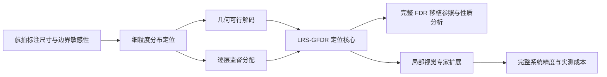

> 历史决策快照：本轮实验顺序及主文/附录位置已更新，以 FEEDBACK_APPLICATION_ZH.md 为准。本文件保留其形成时的设计理由。

> 当前章节与证据位置以EVIDENCE_FOCUS_DECISIONS_ZH.md为准；本文件保留相应前版的研究和命名依据。

> 当前命名已更新为GCDL / LQS；本文件保留此前取舍过程，旧名与当前名的对应见NAMING_DECISIONS_ZH.md。

> 本文件保留上一轮同会全文阅读与结构设计。当前实验命名、表格合并及完整外部评分附录以 EXPERIMENT_DESIGN_DECISIONS_ZH.md 为准；原始阅读结论仍可追溯。

# 从近期 CVM 论文反推：本文的研究脉络与修改依据

## 1. 一篇好论文要让读者相信什么

我的判断是：好论文需要建立一条可核查的论证链。

**任务中确实存在的困难 → 现有方法留下的具体问题 → 有理由的设计选择 → 与选择对应的证据 → 有边界的结论。**

文章是否好，不能用模块数、公式数、图表数或措辞强弱判断。读者应能清楚回答：为什么研究这个问题；为什么需要这项改变；相对于最接近的已有方法究竟新增什么；实验验证了哪部分；增加的成本是否值得。

本轮阅读以 CVM 2025/2026 官方会议程序中的六篇论文为样本，包括四篇航拍检测论文和两篇几何/结构检测论文。这是有针对性的样本阅读，不是整个会议的统计调查，也不能从已发表论文反推出录用原因或录用概率。

## 2. 六篇论文提供的具体启示

| 官方会议论文 | 值得学习的论证组织 | 对本文的具体启示 |
|---|---|---|
| [FGHDet，CVM 2025](https://iccvm.org/2025/papers/s8p2-368-jcst.pdf) | 图 1 先建立尺寸与检测机制失配的动机，表 5 拆分通用增强与后续设计，表 8 对比相近机制 | 开头要有任务依据；完整 FDR 移植应作为强参照，不能把 Baseline→G 的全部收益归给新规则 |
| [DASSF，CVM 2025](https://iccvm.org/2025/papers/lncs/813.pdf) | 图 4/表 2 给标注尺寸统计；表 5 比较具体上采样选择；表 6 再考察跨宿主应用 | 先补任务尺寸事实；某项机制的理由应对应专门证据，不能仅靠总 AP |
| [LME-DETR，CVM 2026](https://iccvm.org/2026/files/papers/265.pdf) | 感受野、尺度处理与监督问题分别对接设计；结果含整体、尺寸与组件视角 | 可以按问题组织方法；必须区分 FGL 回归权重和分类 VFL，也不能混用不同表的基线 |
| [SD-Net，CVM 2026](https://iccvm.org/2026/files/papers/691.pdf) | 表 3 分离通用 P2 增强和新增设计；表 4 专门考察模块放置位置 | 最有价值的是“强起点后的新增价值”和明确设计选择；并非每个组件都必须独立涨点 |
| [Sphere-CenterNet，CVM 2026](https://iccvm.org/2026/files/papers/274.pdf) | 图 1/2 把投影和接缝问题接到几何设计 | 几何贡献要连接具体任务约束；对表中下降的结果应如实解释，不能用协同一词替代证据 |
| [CADSpotting，CVM 2026](https://iccvm.org/2026/files/papers/297.pdf) | 固定查询数、大图窗口和实例一致性对应不同分析；表 6/7 分开推理策略、骨干和表示变化 | 每张表应有明确职责；表示贡献、系统贡献和推理代价要分别回答 |

会议展示核验：[CVM 2025 官方程序](https://iccvm.org/2025/program.htm)、[CVM 2026 官方程序](https://iccvm.org/2026/program.htm)。FGHDet 的正式出版物为 JCST 期刊论文；本文区分会议展示与正式出版信息，不将其误记为 CVM 会议论文集章节。

这些论文的写法也有值得警惕的地方：发表不代表每一条归因、每个基线数值和每项部署表述都充分。本文应学习清楚的论证方法，并对来源中的结果和解释分别核查。

## 3. 对现稿的诊断

### 已经具备的基础

- LRS-GFDR 有清楚的数学定义、源码和完整训练结果；完整 FDR/FGL 移植版是可识别的近邻参照。
- 几何规则有数值回归依据；LRS 有组内总量、排序和离散程度的解析性质。
- 完整系统有 native/common test、全类别 AP 和 batch=8 实测效率记录。

### 当前最值得修的不足

1. **任务到方法之间仍缺一段可见的桥。** 开头说小目标敏感，很快跳到浮点尺寸下界，读者容易把研究理解成通用数值修补。
2. **方法层级和贡献主次不完全一致。** G 只有一个大节，专家、选择性监督和共享 P3 却各占标题；视觉上容易读成三模块拼装。
3. **不同证据承担的任务不够直观。** 数值性质回答能否正确实现，历史 AP 回答配置表现，完整 test 回答系统效果，不能互相替代。
4. **部分相关工作仍像罗列。** 应按视觉信息、定位表示和监督转移组织，并明确最接近方法的区别。

## 4. 推荐的唯一主线

> **面向航拍小目标的边界敏感性，研究 RT-DETR 中分布定位的几何解码与逐层监督分配；LRS-GFDR 定义定位核心，局部视觉专家在该核心上提供精度扩展。**

这里的原创性落在完整定位路径的设计，以及几何可行解码和层内监督分配的具体规则。D-FINE 的离散分布表示、支持集、积分与 FGL 继续明确归属。专家承担扩展职责，不能用其完整系统结果反向证明 G 内每项规则各自有效。

## 5. 章节与图表职责

| 部分 | 应回答的问题 | 主要证据或展示 |
|---|---|---|
| 摘要/引言 | 为什么关注航拍边界定位，本文改变什么 | 新图 1：真实标注尺寸统计与解析位移敏感性 |
| 相关工作 | 最接近的已有路线是什么，本文差异在哪里 | FDR 归属；同会视觉增强与损失设计的区别 |
| 方法 3.1 | 宿主、表示与各路径如何连接 | 总览图；完整移植与 G 的机制表 |
| 方法 3.2 | 如何约束分布解码的几何 | 保中心、两种尺寸下界、surrogate 梯度 |
| 方法 3.3 | 如何分配逐层 FGL 监督 | 同图同层收缩、总量/排序性质；核心原理图 |
| 方法 3.4 | 局部视觉扩展具体做什么 | 共享 P3、专家采样与真正混合框的选择性转移 |
| 方法 3.5 | 如何训练，哪些计算留在推理 | 总目标、调度和推理路径 |
| 实验 4.1 | 指标、数据、检查点、训练与评估如何定义 | 各协议与证据范围 |
| 实验 4.2 | G 相对完整移植如何，几何性质有何依据 | 四行定位版本与原始数值回归；保留所有中间结果 |
| 实验 4.3 | 局部扩展增加了什么 | 五臂 val；最直接匹配的 GB→Full |
| 实验 4.4–4.6 | 完整检测器表现及成本如何 | native/common test、全类别 AP、文献背景和 batch=8 效率 |
| 结论 | 读者得到什么认识，范围在哪里 | 定位核心与扩展的精度/成本；尚待验证的泛化 |

主文目标约 11–12 页；方法中的几何解码与监督分配拥有独立小节，专家的实现细节并入扩展小节。页数由最终排版决定，不以增加页数作为提升质量的目标。

## 6. 本轮能实际补上的证据

使用既有、哈希核验的 converted-label 验证集 GT：548 张图、38,759 个框。只统计标注，不运行模型。

- 在共同评估的 640×640 拉伸坐标下，以等效边长 `sqrt(width × height)` 统计完整分布。
- 原图面积分组与输入坐标统计分开；前者涉及 APs 的面积定义，二者不可混写。
- 对两个同尺寸框的水平位移，解析计算 `IoU = (w − d)/(w + d)`（0≤d≤w），说明固定像素偏移在小框上影响更大。
- 图中明确：这些分析解释任务几何敏感性，不测量模型误差、训练故障频率或模块收益。

这一步填补的是任务动机，不填补因果消融或第二数据集。它也不属于用户排除的逐图预测案例。

## 7. 不能靠结构修改补齐的内容

当前只有一个数据集、一个种子；部分历史配置未全部同源同初态；共同 D-FINE 评估保留不同训练配方；专家和 KD 没有分离验证。完整保留 Clean 高于 G、geometry 配置下降、GB 低于 G 及 Full 的额外成本。

后续若补 UAVDT，应优先使用当前版本的完整系统与明确基线，并复用可核查的协议。现阶段不训练、不联系关闭的服务器、不填占位结果，不以无限轮文字润色代替缺失证据。

## 8. 本轮落实顺序

1. 完成上述文献阅读与论证映射。
2. 新增可复核的 GT 尺寸分析和解析示意，建立任务动机。
3. 按主次调整方法标题层级、引言衔接和相关工作。
4. 保留全部已有数值，复核新增统计与原始 GT。
5. 独立审查是否把任务分析误当模块证明，再编译、逐页检查和打包。

修改完成后，具体状态见 `REVISION_NOTES_ZH.md` 与 `verification.json`。
