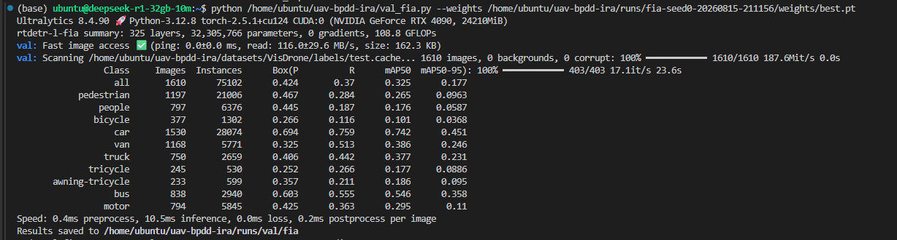
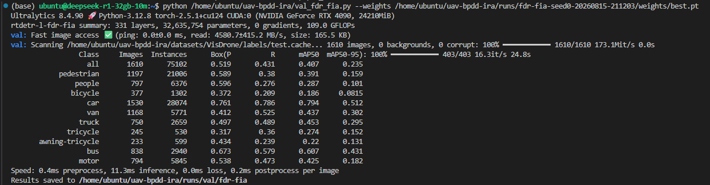

# FIA-only 与 FDR+FIA Release 结果审计

## 已确认上传内容

GitHub Release `DFR-BDPP-FIA` 在 2026-08-17 更新了 FIA-only 与 FDR+FIA 的完整 100 epoch 训练包、日志和 test 截图。两个 ZIP 的 SHA-256 分别为：

- FIA-only：`17eb96a577f20a99370f87f6a33374a7f402a9989a4d692f8961dce0fd9aab0a`；
- FDR+FIA：`30fc5c418a4f24b8e8c6ee3a44ddc88d94ba236225f178e689cfe81540afc900`。

机器可读审计见 [`../evidence/fia_ablation_release_evidence.json`](../evidence/fia_ablation_release_evidence.json)。该 JSON 绑定了 Release、ZIP、日志、ZIP 内 args/results/optimizer 记录和四个 checkpoint 的 SHA-256。

## 总体结果

| 方法 | val 来源 | P | R | AP50 | AP75 | mAP50–95 | test P | test R | test AP50 | test AP75 | test mAP50–95 |
|---|---|---:|---:|---:|---:|---:|---:|---:|---:|---:|---:|
| FIA-only（release topology） | best 训练日志，epoch 88 | 0.48004 | 0.41463 | 0.38605 | 不可用 | 0.21671 | ≈0.424 | ≈0.370 | ≈0.325 | 不可用 | ≈0.177 |
| FDR+FIA（release topology） | best 训练日志，epoch 97 | 0.57750 | 0.49042 | 0.48591 | 不可用 | 0.29408 | ≈0.519 | ≈0.431 | ≈0.407 | 不可用 | ≈0.235 |

训练确已完成 100 epoch。FIA-only 最后一个 epoch 的 val mAP 降至 `0.12375`，该列日志峰值是 epoch 88 的 `0.21671`；FDR+FIA 的 epoch 100 val mAP 为 `0.29335`，该列日志峰值是 epoch 97 的 `0.29408`。这里仅陈述 `results.csv` 的 mAP 列峰值，不据此反推 `best.pt` 的保存判据。

## 与现有基线的算术观察

| 观察 | ΔmAP50–95 | 可否写成正式增益 |
|---|---:|---|
| FIA-only best 训练 val − strict baseline val | −0.240 pp | 否；不同 graph/authority，且是训练日志选优 |
| FIA-only test 截图 − exact baseline test | 约 −0.042 pp | 否；三位小数舍入后符号都不稳 |
| FDR+FIA best 训练 val − strict FDR val | 约 +0.442 pp | 否；不同 graph/authority，且是训练日志选优 |
| FDR+FIA test 截图 − exact FDR test | 约 +0.700 pp | 否；截图舍入、源码身份和 evaluator 合同不完整 |

这批数据给出一个待验证假设：FIA-only 没有显示独立收益，而 FDR+FIA 在 val/test 都呈正向观察，FIA 可能与 FDR 互补。但由于对照合同并不统一，这不是论文可直接引用的严格消融结论。

## 为什么仍不能进入正式主表

1. Release tag 指向 `7b20c610`，早于 FIA-only/FDR+FIA 配置提交；后来出现的 `1d083140` 与运行名一致，但不能证明就是训练时的精确源码状态。
2. Release 配置声明 `nc=10`，模型参数量分别显示为 `32,305,766` 和 `32,635,754`；现有冻结主线配置使用不同的建模合同，参数量不能直接对齐。
3. Release graph 把 FIA 输出同时送入 decoder P3 和重建 P4/P5；当前私密仓库为可比消融规范化成 P3-only。因此 release checkpoint 与当前规范化 YAML 不是同一 graph。
4. val 数值来自训练过程 `results.csv` 的 best epoch，而不是冻结 evaluator 的独立复评；AP75 未导出。
5. test 只有三位小数截图，AP75 缺失，评估脚本也没有显式冻结全部正式参数。

## test 十类别

完整 20 行截图舍入值见 [`fia_ablation_release_test_class_results.csv`](fia_ablation_release_test_class_results.csv)。原始截图如下：

## 下一步

可直接使用已上传 best.pt 做统一独立复评，补出 exact val/test 的 P、R、AP50、AP75、mAP、四尺度和十类别；但若论文需要证明当前规范化的 P3-only FIA，必须用规范化 YAML 重新训练，不能把 release checkpoint 改名后复用。
